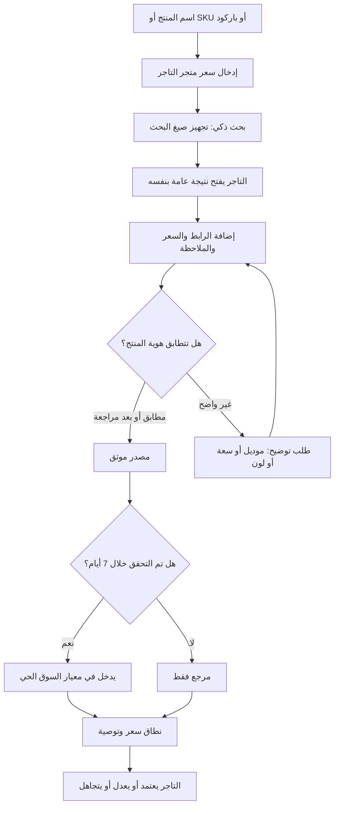

# تصميم آلية البحث الذكي والتوصية بالتسعير

**المنتج:** عين التاجر  
**الحالة:** تصميم تنفيذي مقترح  
**النطاق:** مساعدة التاجر في البحث والتحقق والتوصية بالتسعير، من دون ربط مباشر بواجهات برمجة متاجر المنافسين ومن دون استخراج آلي غير مصرح به.

## النتيجة المطلوبة

تُحوّل ميزة **البحث الذكي** عملية مقارنة الأسعار من إدخال يدوي غير منظم إلى رحلة قصيرة يقودها الذكاء الاصطناعي. يحدد التاجر منتجه وسعره، ثم يجهز التطبيق استعلامات بحث دقيقة ويتيح فتحها في محرك بحث. بعد أن يراجع التاجر صفحة المنتج في المتجر المنافس، يضيف الرابط والسعر الظاهر. يحلل الذكاء الاصطناعي البيانات التي أكدها التاجر، ويكشف احتمال عدم تطابق المنتج، ويرتب الأدلة، ويقترح نطاق سعر مناسب لمتجر التاجر.

> لا يدّعي التطبيق امتلاك سعر حي قبل أن يؤكده التاجر من صفحة عامة. الذكاء الاصطناعي يفسر الأدلة التي أُدخلت له ولا يجمع مواقع المتاجر آليًا أو يتجاوز حمايتها.

## كيف يعمل التطبيق للتاجر خطوة بخطوة

| الخطوة | ما يفعله التاجر | ما يفعله التطبيق والذكاء الاصطناعي | النتيجة الظاهرة |
|---|---|---|---|
| 1. تحديد المنتج | يكتب الاسم، أو SKU، أو يمسح الباركود بالكاميرا. | ينشئ هوية منتج موحدة. يعطي الباركود وSKU أولوية أعلى من الاسم. | بطاقة منتج فيها الاسم والمعرّفات المتاحة. |
| 2. إدخال سعر المتجر | يكتب سعره الحالي بالريال. | يتحقق من صيغة الرقم ويحوّله إلى هللات للحساب الدقيق. | سعر التاجر الحالي. |
| 3. إنشاء خطة البحث | يضغط «بحث ذكي». | يقترح ثلاث صيغ بحث: بالباركود، وSKU، والاسم مع المواصفات والسعودية. | أزرار بحث واضحة ومحرك بحث مناسب لكل صيغة. |
| 4. مراجعة المصادر | يفتح التاجر النتائج في Google أو Bing ويختار صفحة المنتج الفعلية. | يذكّر التطبيق بالتحقق من الموديل والسعة واللون وحالة التوفر قبل نقل السعر. | صفحة تعليمات قصيرة وقائمة تحقق. |
| 5. إضافة دليل السعر | يضيف اسم المتجر والرابط العام HTTPS والسعر الظاهر. ويمكنه إضافة ملاحظة مثل «شحن غير شامل». | يتحقق الخادم من الرابط والصيغة والسعر. يسجل وقت التحقق على الخادم. | سجل مصدر موثق مع رابط وتاريخ. |
| 6. فحص التطابق | يضغط «تحليل التوافق». | يقارن الذكاء الاصطناعي اسم المنتج ومواصفاته التي أدخلها التاجر مع عنوان المصدر وملاحظته. لا يفتح الرابط ولا يستخرج محتواه تلقائيًا. | حالة: مطابق بدرجة عالية، يحتاج مراجعة، أو غير مناسب للمقارنة. |
| 7. بناء المقارنة | يضغط «احسب المقارنة». | يستخدم فقط المصادر التي أكدها التاجر وتاريخها خلال آخر 7 أيام. يستبعد المصادر القديمة من معيار السوق الحي، مع بقائها مرئية كمرجع. | أقل سعر حديث، الوسيط، أعلى سعر، وفارق سعر التاجر. |
| 8. التوصية | يختار هدفه: سرعة البيع، توازن، أو هامش أعلى. | يطبق محرك قواعد واضحًا، ثم يصوغ الذكاء الاصطناعي تفسيرًا قصيرًا قابلًا للمراجعة. | نطاق مقترح وسعر مستهدف وسبب التوصية. |
| 9. اعتماد القرار | يختار التاجر «اعتماد»، «تعديل»، أو «تجاهل». | يحفظ القرار والسبب، من دون تغيير سعر المتجر تلقائيًا. | سجل قرارات يساعد في متابعة أثر التسعير لاحقًا. |

## رحلة مستخدم مختصرة



## واجهة «البحث الذكي» المقترحة

تضاف داخل شاشة **باحث الأسعار** الحالية كتسلسل من ثلاث بطاقات بدل شاشة معقدة جديدة.

### بطاقة هوية المنتج

تعرض الاسم، الباركود، SKU، وسعر التاجر. إذا كان الباركود موجودًا، يظهر أولًا لأنه أفضل دليل على أن المنتج نفسه. إذا لم يوجد، يطلب التطبيق خصائص اختيارية تقلل الالتباس: العلامة التجارية، رقم الموديل، السعة أو المقاس، اللون، وحالة المنتج (جديد أو مستعمل).

### بطاقة خطة البحث

ينتج التطبيق صيغًا جاهزة ولا يرسل أي طلب إلى مواقع المتاجر. مثال لمنتج له باركود:

| أولوية | صيغة البحث | الغرض |
|---|---|---|
| 1 | `628XXXXXXXXXX سعر السعودية` | أدق بحث عندما يوجد باركود. |
| 2 | `SKU-001 اسم العلامة سعر السعودية` | بديل عندما يكون SKU متاحًا. |
| 3 | `اسم المنتج الموديل السعة سعر السعودية` | يستخدم فقط عند غياب المعرّفات. |

تفتح الأزرار محركات البحث في متصفح الجهاز. لا تُفتح صفحات المنافسين من الخادم، ولا ينفذ التطبيق زحفًا أو استخراجًا خلفيًا.

### بطاقة إضافة دليل ومراجعته

يبقى إدخال اسم المصدر والرابط والسعر جزءًا أساسيًا، ويضاف إليه حقلان اختياريان: **عنوان المنتج كما ظهر في الصفحة** و**ملاحظات السعر**. تساعد هذه الحقول الذكاء الاصطناعي على فحص التطابق. لا يجوز إدخال كلمات مرور أو بيانات بطاقات أو مفاتيح API أو معلومات شخصية للمنافسين.

بعد الحفظ، تظهر شارة الحالة التالية:

| حالة المصدر | معناها | أثرها على التوصية |
|---|---|---|
| **مطابق بدرجة عالية** | باركود أو SKU متطابق، أو اسم وموديل ومواصفات متوافقة. | يدخل في المقارنة. |
| **يحتاج مراجعة** | الاسم قريب لكن خاصية مهمة غير موجودة أو غير واضحة. | لا يدخل قبل تأكيد التاجر. |
| **غير مناسب** | اختلاف واضح في موديل أو حجم أو حالة المنتج. | لا يدخل في المقارنة. |
| **قديم مرجعي** | تم التحقق منه منذ أكثر من 7 أيام. | لا يدخل معيار السوق الحي؛ يعرض كسياق فقط. |

## منطق مطابقة المنتج

يعتمد النظام قواعد حتمية قبل الذكاء الاصطناعي، لأن الباركود وSKU أدق من أي تخمين لغوي.

1. إذا تطابق الباركود تمامًا، يمنح المصدر **مطابقة عالية** ما لم يذكر التاجر اختلافًا جوهريًا في حالة المنتج أو الباقة.
2. إذا لم يوجد باركود وتطابق SKU تمامًا، يمنح المصدر **مطابقة عالية**.
3. إذا لم توجد معرّفات، يقارن الذكاء الاصطناعي الاسم والعلامة التجارية والموديل والسعة واللون. إذا غابت خاصية مؤثرة، يطلب مراجعة بدل تخمين.
4. لا يقارن منتجًا جديدًا مع مستعمل، أو نسخة محلية مع مستوردة مختلفة، أو باقة متعددة مع وحدة مفردة.
5. لا تدخل المصادر ذات العملة أو حالة التوفر غير الواضحة في توصية نهائية إلى أن يؤكدها التاجر.

## منطق التوصية بالتسعير

التوصية ليست سعرًا مفروضًا؛ هي اقتراح يشرح أدلته ويترك القرار للتاجر. يبدأ المحرك بحساب الأسعار الحديثة الموثقة فقط:

- **L** = أقل سعر منافس حديث.
- **M** = السعر الوسيط للمصادر الحديثة، وهو أقل تأثرًا بسعر شاذ.
- **H** = أعلى سعر منافس حديث.
- **S** = سعر متجر التاجر الحالي.

لا تظهر توصية رقمية عند عدم وجود مصدر حديث مطابق. عند وجود مصدر واحد فقط، يعرض التطبيق «إشارة أولية» مع ثقة منخفضة بدل توصية حاسمة.

| هدف التاجر | السعر المستهدف الابتدائي | متى يستخدمه التطبيق |
|---|---:|---|
| سرعة البيع | `L` أو أقل منه بهامش صغير يحدده التاجر | عند وجود مخزون زائد أو هدف تصفية. |
| توازن | قريب من `M` | الإعداد الافتراضي عند وجود مصدرين حديثين مطابقين أو أكثر. |
| هامش أعلى | بين `M` و`H` | عندما توجد ميزة خدمة أو ضمان أو توصيل يبرر فرق السعر. |

ثم يطبق التطبيق حدودًا قبل عرض السعر المقترح:

1. لا يقترح سعرًا أدنى من **الحد الأدنى الذي يحدده التاجر** أو تكلفة المنتج عند توفرها.
2. يوضح أن الشحن، التركيب، الضمان، الهدايا، والكوبونات قد تجعل الأسعار غير متساوية.
3. يحسب الفرق بالريال والنسبة المئوية: `((S - السعر المستهدف) ÷ السعر المستهدف) × 100`.
4. يعرض **نطاقًا** مثل «بين 189 و199 ر.س» بدلاً من رقم يبدو يقينيًا حين تكون الأدلة محدودة.
5. يرفق سببًا بسيطًا: «سعرك أعلى 6.2% من وسيط مصدرين حديثين مطابقين».

## دور الذكاء الاصطناعي بدقة

يعمل الذكاء الاصطناعي على الخادم فقط، ولا يتلقى إلا حقول المنتج والدليل التي أدخلها التاجر. يستخدم مخرجًا منظمًا لاختيار واحدة من الحالات: `high_match` أو `review_needed` أو `not_comparable`. كما يكتب تفسيرًا قصيرًا من دون اختراع سعر أو مصدر أو مواصفة غير موجودة.

مثال مدخل آمن للذكاء الاصطناعي:

```text
بيانات منتج التاجر: الاسم: سماعة X، الباركود: 6280000000000، اللون: أسود.
دليل التاجر من مصدر عام: الاسم الظاهر: سماعة X لاسلكية أسود، السعر: 199 ر.س، ملاحظة: ضمان محلي.
المطلوب: قيّم تطابق المنتج. لا تخترع أي بيانات ولا تقرأ الرابط.
```

مثال مخرج متوقع:

```json
{
  "matchStatus": "high_match",
  "confidence": 0.92,
  "reason": "يتطابق الباركود والاسم واللون؛ لا يظهر اختلاف مؤثر في المواصفات.",
  "missingFields": []
}
```

لا يُسمح للذكاء الاصطناعي بتنفيذ أي مما يلي:

- فتح رابط يقدمه المستخدم أو جلب محتوى موقع منافس.
- ادعاء وجود سعر أو مخزون لم يدخله التاجر.
- اتخاذ قرار تغيير سعر المتجر تلقائيًا.
- إرسال بيانات العميل أو المتجر إلى مواقع المنافسين.

## البيانات التي تحفظ في التطبيق

تضاف البيانات تدريجيًا ولا تحتاج إلى حفظ أي بيانات حساسة من المنافسين.

| الكيان | الحقول الأساسية | سبب الحفظ |
|---|---|---|
| هوية منتج البحث | الاسم، SKU، الباركود، العلامة، الموديل، المواصفات | منع مقارنة منتجات متشابهة ظاهريًا. |
| دليل سعر | المصدر، رابط HTTPS، السعر، العملة، وقت التحقق، الملاحظة | إبقاء التوصية قابلة للمراجعة. |
| نتيجة المطابقة | الحالة، الثقة، السبب، الحقول الناقصة، وقت التحليل | تمييز الدليل القابل للمقارنة. |
| توصية التسعير | الهدف، النطاق، السعر المستهدف، مصادر الحساب، التحذيرات | شرح التوصية وإعادة إنتاجها لاحقًا. |
| قرار التاجر | اعتمد أو عدّل أو تجاهل، السعر المختار، ملاحظة اختيارية | قياس أثر القرارات دون تغيير تلقائي. |

## واجهات API المقترحة

تبقى الواجهة الحالية `priceResearch.list` و`priceResearch.addObservation` لقراءة المصادر وإضافتها. تضاف إجراءات صغيرة ومحمية بحالة تجربة أو اشتراك سارية:

| الإجراء | المدخلات | الناتج | الضوابط |
|---|---|---|---|
| `priceResearch.buildSearchPlan` | هوية المنتج | صيغ بحث وروابط Google/Bing فقط | لا يتصل بأي متجر. |
| `priceResearch.analyzeMatch` | هوية المنتج ودليل كتبه التاجر | حالة التطابق والثقة والسبب | يستدعي LLM على الخادم، بمخرج JSON منظم. |
| `priceResearch.getRecommendation` | سعر التاجر، هدف التسعير، مصادر مؤكدة حديثة | نطاق وسعر مستهدف وتحذيرات | حساب حتمي أولاً؛ LLM يشرح فقط. |
| `priceResearch.recordDecision` | توصية، قرار التاجر، سعر مختار اختياري | سجل قرار | لا يغير سعر المنتج تلقائيًا. |

## الحماية والخصوصية

تنفذ كل عمليات التحقق في الخادم. يجب قبول روابط HTTPS عامة فقط، مع رفض العناوين المحلية والخاصة، وعدم جعل الخادم يزور الرابط؛ هذا يحمي من طلبات الوصول إلى خدمات داخلية لا ينبغي كشفها. توصي OWASP بالتحقق من المدخلات على نظام موثوق، وتوضح أن جلب رابط يقدمه المستخدم من دون تحقق قد يسبب ثغرة SSRF. [1] [2]

يحدّ الإجراء `analyzeMatch` طول الحقول، ويستخدم مخرج JSON صارمًا، ولا يحتفظ بنصوص تفوق ما يحتاجه التاجر لتفسير التطابق. يجب تحديد معدل استخدام لكل تاجر، مثل 20 تحليل تطابق في الساعة، وعرض حالة «حاول لاحقًا» عند تجاوزه. تحفظ السجلات تحت حساب التاجر فقط.

## حالات لا يجب فيها إعطاء توصية سعرية

يمتنع التطبيق عن تقديم سعر مستهدف في الحالات التالية ويشرح السبب بدلاً من ذلك:

- لا يوجد مصدر حديث أكد التاجر أنه لنفس المنتج.
- يوجد مصدر واحد فقط ولم تتطابق هوية المنتج بدرجة عالية.
- لا توجد تكلفة أو حد أدنى للسعر، والتاجر اختار هدفًا قد يؤدي إلى بيع بخسارة.
- المنتج غير متوفر، أو السعر مرتبط بكوبون أو عضوية أو عرض مؤقت غير قابل للمقارنة.
- تختلف شروط الشحن أو الضمان أو الباقة بشكل مؤثر.

## مراحل التنفيذ المقترحة

تبدأ المرحلة الأولى بإضافة «خطة البحث الذكي» وقائمة تحقق وملاحظات المصدر. هذه المرحلة لا تحتاج إلى مصدر خارجي أو موافقات، وتفيد التاجر فورًا.

في المرحلة الثانية، يضاف تحليل تطابق المنتج بالذكاء الاصطناعي على الخادم مع مخرج منظم ومراجعة بشرية إلزامية للحالات غير الواضحة.

في المرحلة الثالثة، يضاف محرك التوصية الحتمي ونطاقات التسعير وسجل قرار التاجر. لا يُسمح بالتعديل التلقائي لسعر المتجر.

لا تتحول المرحلة الرابعة، وهي البحث الآلي أو استيراد أسعار المتاجر، إلى تنفيذ إلا إذا وُجد مصدر بيانات مرخص أو إذن رسمي صريح. هذا الشرط منفصل تمامًا عن الذكاء الاصطناعي، لأن AI لا يمنح صلاحية لاستخراج بيانات من مواقع الغير.

## معايير النجاح

تعد الميزة ناجحة عندما يستطيع التاجر إكمال مقارنة لمنتج واحد في أقل من دقيقتين بعد العثور على الصفحات، ويرى دائمًا مصدر كل رقم وتاريخ التحقق منه، ولا يحصل على توصية رقمية من أدلة غير كافية، ويمكنه فهم سبب التوصية وتعديلها أو تجاهلها دون أي تغيير تلقائي في سعر متجره.

## References

[1]: https://cheatsheetseries.owasp.org/cheatsheets/Input_Validation_Cheat_Sheet.html "OWASP Input Validation Cheat Sheet"
[2]: https://cheatsheetseries.owasp.org/cheatsheets/Server_Side_Request_Forgery_Prevention_Cheat_Sheet.html "OWASP Server-Side Request Forgery Prevention Cheat Sheet"
